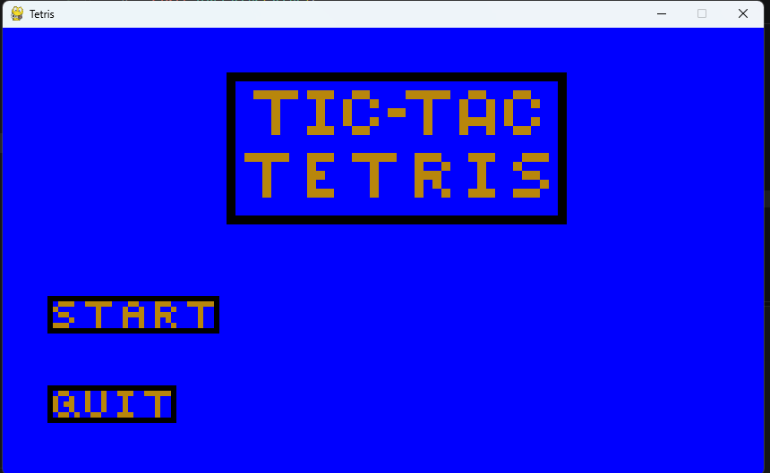
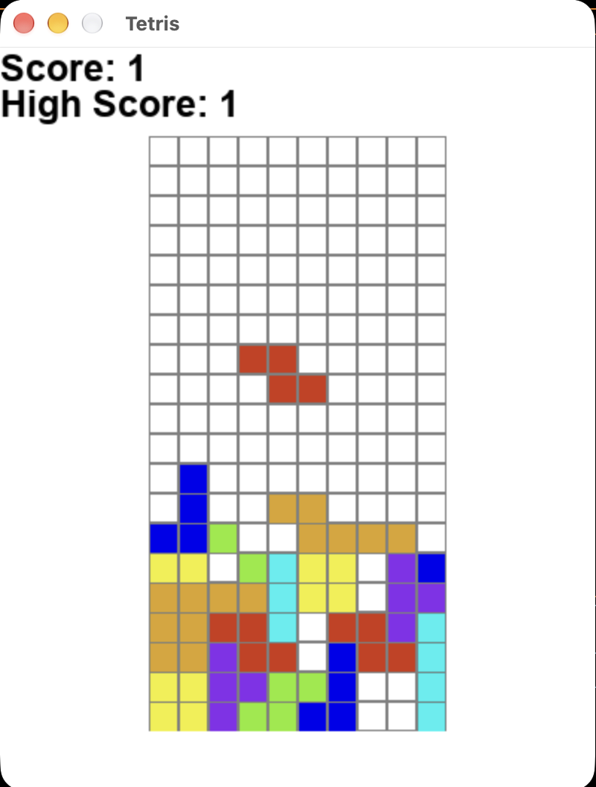
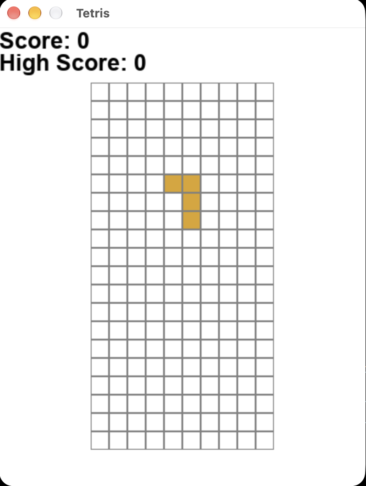
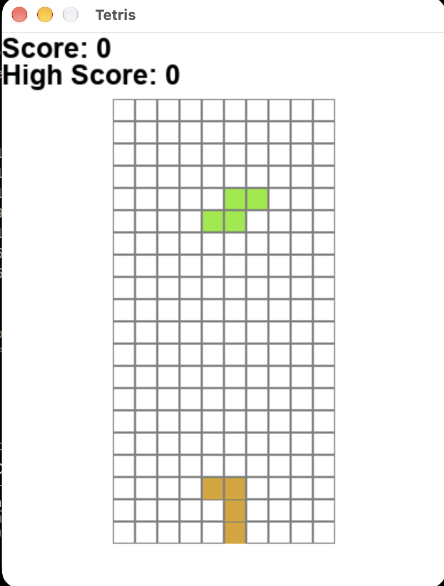

# Current Milestones

The Milestones (goals) for the week
   - Prepare for S1P

---

# UI Overhaul - Tanner Andrews

- Most of this sprint was background work
- Next sprint will add more visuals as the framework is mostly there

---

# Mission Mode - Joseph Galluchi

this is a mode where a user would have to help clear out a pre-defined board

---

# Quality of Life - Joseph Galluchi

This feature would bring the piece down instantly without delay at the push of the space key

---

# The progress

- Burndown rates
  - Features: 0/4
  - Requirements: 5/12

---

# Tests counts
  - Acceptance tests:4
  - Integration tests: 3
  - Unit tests: 66
- Total LoC (lines of code): 1376

---

# Questions?
